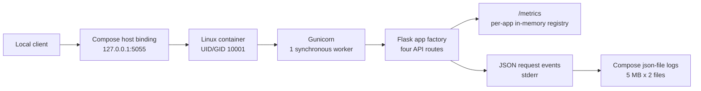
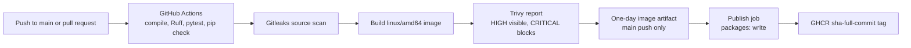

# Project Atlas architecture

This document is the canonical architecture reference for the current tracked
repository. It describes implemented source and configuration, plus the
historical local Kubernetes smoke test. It does not imply that a cluster,
container, CI job, AWS account, or external monitoring service is running now.

## System boundaries and assumptions

Atlas is a stateless Flask API packaged as a Linux container. Its tracked code
does not use a database, persistent volume, user authentication, cloud SDK, or
AWS resource. The API has four application routes and a Prometheus exposition
route. Local deployment and CI are implemented; AWS provisioning is not.

The current Kustomize and Helm defaults pin the verified GHCR image
`ghcr.io/avinashmnth2507-dev/project-atlas@sha256:32cec7ad8da3303f038b15ca2b6369f6c86ba28c7ed8d4709ae164df729af5fa`,
published for source commit `989de965f9ea04f1f4292fa6c819aeb49daa8f31`.
The historical Minikube smoke test used an earlier image from commit
`d66b09be89258e0898ef559fc5c7b8e71b5ece32`, before `/metrics` and structured
request logging. Updating the pins does not establish a deployment of the new
image to a cluster.

## Current application architecture

`atlas:create_app()` configures one named JSON logger before constructing the
Flask app, loads environment-based configuration, registers the four API
blueprints, installs request logging, and initializes a per-application
Prometheus registry. The application runs behind one synchronous Gunicorn
worker in the container. The routes are stateless and return JSON:

| Route | Purpose |
| --- | --- |
| `GET /` | Welcome and running status |
| `GET /health` | Health, application name, and version |
| `GET /info` | Application name, version, and configured environment |
| `GET /version` | Package version |
| `GET /metrics` | Prometheus text exposition on the same port |

The host mapping is specific to Docker Compose; the container listens on port
`5000`. Compose captures stdout and stderr with its configured `json-file`
rotation. Gunicorn access logging is disabled so the app's structured request
events are the sole request completion logs. Gunicorn error logging remains
enabled for server-level errors.

## Observability flow

The metrics module records `atlas_http_requests_total` and
`atlas_http_request_duration_seconds` with only normalized method, matched
route template (or `unmatched`), and status labels. `/metrics` is excluded from
both metrics. The registry exists in process memory for each Flask app
instance; no Prometheus multiprocess mode or cross-process aggregation is
configured. There is no Prometheus server, scrape configuration, alerting, or
Grafana service in the repository.

The logging hook emits a JSON `http.request.completed` event with a UTC
timestamp, level, generated request ID, bounded method, route template, final
status, and duration. Successful `/health` and `/metrics` requests are omitted
from logs; errors for those routes are retained. The ID is returned in
`X-Request-ID`, incoming IDs are ignored, and IDs never become metric labels.
Raw URLs, query strings, headers, cookies, bodies, exception messages, and
tracebacks are not placed in application log records. In production, unexpected
non-HTTP exceptions produce a generic 500 and only the exception class is
included in the completion event. Debug mode re-raises exceptions for local
interactive debugging.

Compose captures the app's stderr stream and applies local rotation. In
Kubernetes, the container runtime captures process output, but no centralized
collector, durable log store, or log access policy is configured. Metrics and
logs are application capabilities only; collection and retention services are
not deployed.

## CI and image publication

The workflow in `.github/workflows/ci.yml` runs on pushes to `main`, pull
requests targeting `main`, and manual dispatch. It pins its actions to commit
SHAs, uses Ubuntu `24.04` and Python `3.14`, validates source and dependencies,
scans tracked files with Gitleaks, builds once for `linux/amd64`, and scans the
built image with Trivy CLI `0.76.1`. HIGH and CRITICAL findings are reported;
only CRITICAL findings fail the Trivy gate. For a successful push to `main`,
the same scanned image is transferred using a one-day artifact, checksum
verified, loaded by the publish job, and pushed to GHCR with the full source
commit SHA in the tag. The publish job alone has `packages: write` and uses
`GITHUB_TOKEN`. No mutable `main` or `latest` image tag is published.

This documents workflow behavior, not the result of a run for the latest
commit. The screenshots record earlier successful CI and first-publish
milestones. A local Trivy comparison on 2026-10-22 observed 48 HIGH and 0
CRITICAL findings with Trivy `0.71.1` and a cached database; the workflow's
Trivy `0.76.1` database can report different findings. HIGH vulnerabilities
remain a known risk and are currently non-blocking.

## Runtime and deployment alternatives

### Docker Compose

`compose.yaml` builds from the repository Dockerfile and maps host loopback
`127.0.0.1:5055` to container port `5000`. The service uses a read-only root
filesystem, memory-backed `/tmp` with `noexec,nosuid` and a `16m` cap, drops all
capabilities, disables privilege escalation, limits PIDs to `64`, CPU to `1`,
and memory to `256m`, and rotates JSON-file logs at `5m` across two files. The
Dockerfile pins the Python `3.14.9` slim Trixie base image by digest. CI
separately builds the application image for `linux/amd64`; the repository does
not document validation for other build targets. The container runs as
non-root UID/GID `10001`, uses one synchronous Gunicorn worker, and has a
`/health` Docker health check.

Compose's `image` value is a local tag paired with a build context. Use
`docker compose -f compose.yaml up --build --detach api` to build the checkout
before starting it; the tag alone does not identify a GHCR release.

### Kustomize and Helm

Kustomize and Helm are alternative managers for the same `atlas-api`
Deployment and `ClusterIP` Service. Do not apply both over the same workload.
Kustomize currently defines Namespace `atlas` with
`pod-security.kubernetes.io/enforce=restricted`. The Helm chart does not define
the Namespace and requires it to exist with that PSA label. A change of owner
requires a reviewed handoff or a separate namespace.

The Deployment uses one replica, image port `5000`, digest-pinned GHCR image,
`/health` startup/readiness/liveness probes, `100m` CPU and `96Mi` memory
requests, and `1` CPU and `256Mi` memory limits. It disables service-account
token automount; runs non-root with UID/GID/fsGroup `10001`; uses
`RuntimeDefault` seccomp; disables privilege escalation; makes the root
filesystem read-only; drops all capabilities; and provides a memory-backed
`/tmp` capped at `16Mi`.

The current manifest and chart pin
`ghcr.io/avinashmnth2507-dev/project-atlas@sha256:32cec7ad8da3303f038b15ca2b6369f6c86ba28c7ed8d4709ae164df729af5fa`,
verified for source tag `sha-989de965f9ea04f1f4292fa6c819aeb49daa8f31`.
The historical local smoke test
used Minikube profile `atlas-smoke`, Kubernetes `v1.35.1`, `2` CPUs and
`2048MiB`; its screenshot records the four API endpoints. It used the earlier
image from source commit `d66b09be89258e0898ef559fc5c7b8e71b5ece32` and does not
establish that the currently pinned image is deployed or that the cluster is
currently running. See `kubernetes/README.md` and `helm/atlas/README.md`.

`kubectl kustomize ./kubernetes`, `helm lint`, and `helm template` are local
render/lint operations. They do not establish API-server admission, scheduling,
image availability, or live runtime health.

## Terraform scope

`terraform/` constrains Terraform to `>=1.16.0, <1.17.0`, selects
`hashicorp/aws` `~>6.0` with lockfile version `6.70.0`, configures the provider
region from `var.aws_region`, and defaults that variable to `ap-southeast-2`.
There are no resource, data, module, or backend blocks. This is a provider-only
foundation: it does not provision AWS infrastructure, select an account, or
configure credentials. There is no remote state design or cost estimate.

## Trust boundaries and limitations

- The Compose port is bound to loopback. Kubernetes exposes a `ClusterIP`;
  local host access in the recorded smoke test used a temporary port-forward.
- The API and `/metrics` have no authentication or authorization. Do not expose
  them through a public ingress without a separately reviewed access-control
  design.
- A request ID is an opaque correlation value, not an identity or credential.
- The production 500 log intentionally omits exception text and stack traces.
  This limits diagnosis to the exception class, request ID, route template,
  status, and duration; secure trace collection is not implemented.
- The service has no persistent storage, HA, autoscaling, TLS termination,
  secret management, database, public ingress, or deployed monitoring/logging
  backend.
- The historical Kubernetes smoke test predates the observability-enabled
  image now pinned by the manifests; repeat it before claiming those features
  have been validated in a Kubernetes runtime.

## Evidence and future extensions

Tracked evidence includes the [CI run](screenshots/05-github-actions/18-ci-run-success.png),
[initial GHCR publication](screenshots/05-ghcr/19-ghcr-image-published.png), and
[local Kubernetes smoke test](screenshots/07-kubernetes/20-kubernetes-local-smoke-test.png).
The latter is historical evidence for the earlier pinned image.

Possible next steps are to re-run Kubernetes smoke validation against the
current pinned digest, design a restricted
Prometheus scrape path and log retention boundary, and only then define a
costed AWS deployment and Terraform state strategy. These are proposals, not
implemented services. See [the roadmap](docs/architecture/07-roadmap.md).
