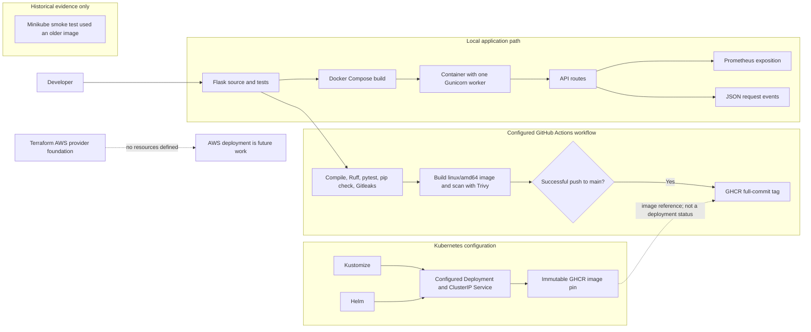
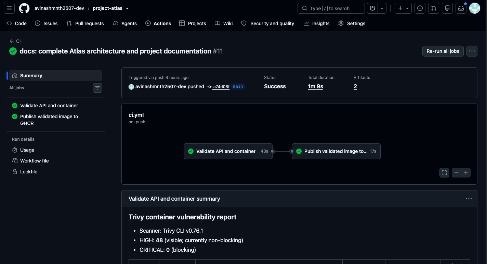
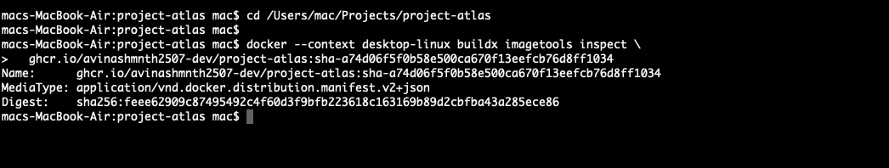
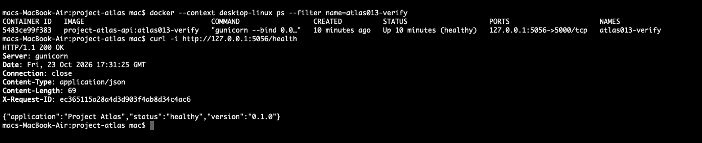
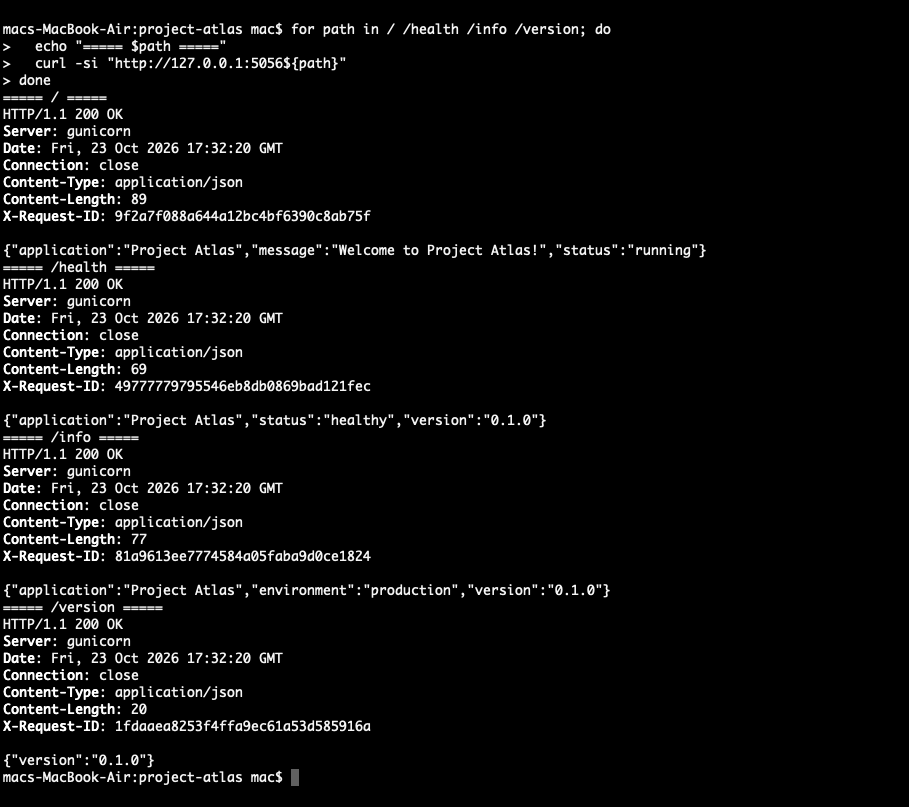
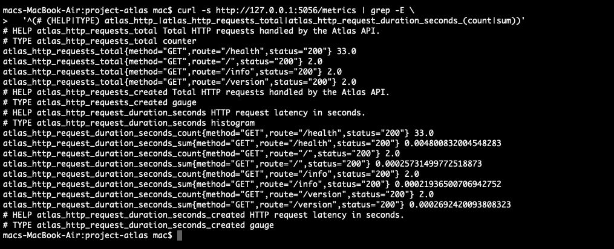
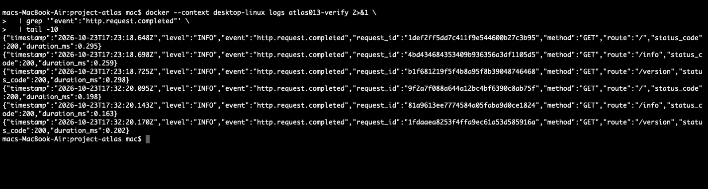
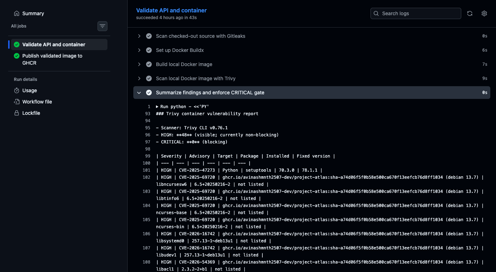
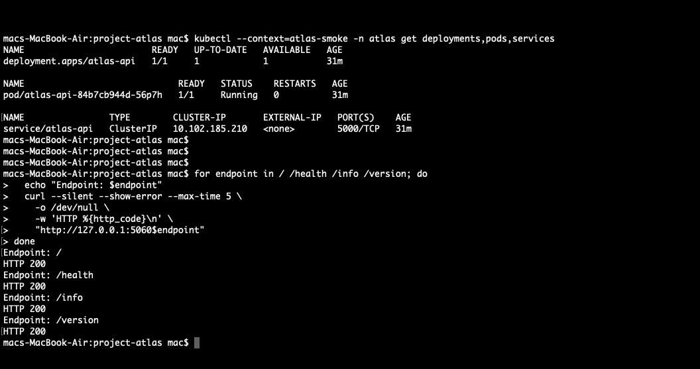

<h1 align="center">Project Atlas</h1>

<p align="center">
  A hands-on DevOps and Platform Engineering portfolio built around a small,
  secure Flask API and a verifiable container delivery workflow.
</p>

<p align="center">
  <a href="https://github.com/avinashmnth2507-dev/project-atlas/actions/workflows/ci.yml">
    
  </a>
  
  
</p>

Atlas demonstrates a practical path from application code to a scanned GHCR
image, with local Docker Compose support and Kubernetes deployment
configurations. It is a learning portfolio focused on delivery and runtime
engineering, not a production platform.

## Overview

The project keeps the application intentionally small so the engineering
workflow is easy to inspect. The Flask API has a focused test suite, bounded
Prometheus-compatible metrics, privacy-conscious JSON request logs, a hardened
container image, and GitHub Actions checks that scan before publishing.

The repository also contains Kustomize and Helm definitions for the same
single-replica Kubernetes workload, plus a Terraform provider foundation for
AWS Sydney (ap-southeast-2). Terraform defines no AWS resources. These
configuration files do not establish a current cluster or cloud deployment.

## Engineering highlights

- **Application:** Flask application factory with `/`, `/health`, `/info`,
  `/version`, and `/metrics`.
- **Request observability:** Per-application Prometheus registry, bounded
  method/route/status labels, latency histogram, generated `X-Request-ID`,
  and structured JSON request-completion events.
- **Container:** Digest-pinned Python base image, non-root UID/GID 10001,
  one synchronous Gunicorn worker, and a Docker health check.
- **Local runtime:** Docker Compose binds the API only to
  `127.0.0.1:5055` and applies read-only filesystem, capability, privilege,
  process, CPU, memory, temporary storage, and log-rotation controls.
- **Delivery:** GitHub Actions validates Python, scans tracked source with
  Gitleaks, builds a `linux/amd64` image, scans it with Trivy, then publishes
  the already-scanned image to GHCR on successful pushes to `main`.
- **Kubernetes:** Kustomize and Helm describe equivalent workload resources
  and are alternative deployment owners.
- **Infrastructure:** Terraform currently configures only the AWS provider
  and default region; it defines no infrastructure resources.

## Recent progress

This follow-on verification is separate from the ATLAS-001–010 milestone
history in the roadmap:

- **ATLAS-013:** Verified an isolated local Compose run of the current
  application, including health, API endpoints, metrics, JSON logs, and
  container security. Screenshots 23–26 record that temporary run.
- **ATLAS-014:** Captured successful CI/GHCR and Trivy evidence for an earlier
  image. These screenshots do not report current CI status or current
  vulnerability findings.
- **ATLAS-015:** Updated Kustomize and Helm to the verified immutable image
  pin and validated their output offline. This did not deploy the pinned image
  to a Kubernetes cluster.

## Architecture

This diagram separates configured local and CI paths from Kubernetes
definitions, historical test evidence, and future AWS work. It does not depict
live infrastructure.



Compose serves the local application on loopback. The application emits
metrics on its existing HTTP port and writes JSON logs to stderr. Kubernetes
manifests configure a workload and internal Service, but the recorded Minikube
smoke test used an older image and is historical evidence only.

## Technology stack

| Area | Repository configuration |
| --- | --- |
| Application | Python 3.14, Flask 3.1.3 |
| WSGI and metrics | Gunicorn 26.1.0, one synchronous worker; prometheus-client 0.26.0 |
| Tests and lint | pytest (8 or newer), Ruff 0.17.1 |
| Container | Python 3.14.9 slim Trixie base, pinned by digest |
| Local runtime | Dockerfile and Docker Compose |
| CI and scanning | GitHub Actions, Gitleaks 8.30.1, Trivy CLI 0.76.1 |
| Kubernetes packaging | Kustomize manifests and Helm chart 0.1.0 |
| Infrastructure foundation | Terraform 1.16.4 and AWS provider 6.70.0 |

Tool versions shown here come from repository constraints or recorded
environment reviews; they are not all enforced as local tool requirements.

## Quick start

### Test and lint the application

From the repository root, create and activate the documented development
environment, then run the same checks used by CI:

```bash
cd app
python3.14 -m venv .venv-atlas002
source .venv-atlas002/bin/activate
python -m pip install -r requirements-dev.txt
python -m compileall -q src tests run.py
python -m ruff check --select E4,E7,E9,F src tests run.py
python -m pytest -q
python -m pip check
```

### Run Flask on loopback

From `app/`, with the environment active:

```bash
FLASK_ENV=development PYTHONPATH=src python -m flask \
  --app atlas:create_app run --host 127.0.0.1 --port 5000
```

Then open `http://127.0.0.1:5000/health` or use the endpoints below. The
separate `app/run.py` entry point binds the Flask development server to
`0.0.0.0:5000`; direct execution can expose it to other devices on the local
network. Prefer the loopback-bound command for local development.

### Build and run with Docker Compose

From the repository root:

```bash
docker compose -f compose.yaml up --build --detach api
docker compose -f compose.yaml ps
curl --fail http://127.0.0.1:5055/health
docker compose -f compose.yaml logs --follow api
```

Compose builds from the current checkout and uses a repository-defined local
image tag. The host binding is loopback-only. Stop this Compose project with
`docker compose -f compose.yaml down` when finished; do not use broad Docker
prune commands to clean up this project.

## API endpoints

| Method | Path | Response |
| --- | --- | --- |
| GET | `/` | Welcome message and running status |
| GET | `/health` | Health status, application name, and version |
| GET | `/info` | Application name, version, and configured environment |
| GET | `/version` | Application version |
| GET | `/metrics` | Prometheus text exposition from the application process |

The four application API routes return JSON. The metrics endpoint is on the
same application port and has no authentication; keep it inside trusted
network boundaries.

## CI/CD and security

The [CI workflow](.github/workflows/ci.yml) runs on pushes and pull requests
targeting `main`, and on manual dispatch. It compiles Python, runs Ruff,
pytest and `pip check`, scans the checked-out source snapshot with Gitleaks,
builds one `linux/amd64` image, and scans OS and Python-library vulnerabilities
with Trivy.

The workflow reports HIGH and CRITICAL Trivy findings. HIGH findings are
currently nonblocking; any CRITICAL finding fails the scan gate. Historical
scan evidence includes HIGH findings, so Atlas must not be described as
vulnerability-free. A recorded local scan on 2026-10-22 reported 48 HIGH and
0 CRITICAL findings for its tested candidate using Trivy 0.71.1 and a cached
database. That is not a current scan; counts can change with the image,
scanner, and vulnerability database.

Only a successful push workflow for `main` uploads the scanned image through a
one-day Actions artifact to a separate job with `packages: write`. That job
verifies the archive checksum and publishes a `sha-<full-commit-sha>` tag to
GHCR. The validation job has read-only repository permissions. CI's
`linux/amd64` setting describes the image build platform; it is separate from
the Dockerfile's immutable base-image digest pin. The repository does not
document validation for other build platforms.

The container runs as UID/GID 10001. Compose sets a read-only root filesystem,
memory-backed `/tmp` with a 16 MiB cap, `noexec` and `nosuid`, drops all
Linux capabilities, disables privilege escalation, and limits PIDs, CPU,
memory, and log-file size. The application image exposes port 5000; Compose
publishes it only on host loopback at port 5055.

## Kubernetes and Helm

Kustomize and Helm render the same `atlas-api` Deployment and ClusterIP
Service. They are alternative owners: do not manage the same Deployment and
Service with both tools at once. Kustomize includes the `atlas` Namespace
with the Restricted Pod Security Admission label. Helm expects that Namespace
to exist and does not create or take ownership of it.

The configured workload has one replica, port 5000, startup/readiness/liveness
probes on `/health`, requests of 100m CPU and 96 MiB, and limits of 1 CPU and
256 MiB. It runs as non-root UID/GID 10001 with RuntimeDefault seccomp, no
service-account token automount, a read-only root filesystem, no privilege
escalation, all capabilities dropped, and a 16 MiB memory-backed `/tmp`.

Both deployment definitions currently pin:

```text
ghcr.io/avinashmnth2507-dev/project-atlas@sha256:32cec7ad8da3303f038b15ca2b6369f6c86ba28c7ed8d4709ae164df729af5fa
```

This verified image was published for source commit
`989de965f9ea04f1f4292fa6c819aeb49daa8f31`. The historical Minikube smoke
test used an earlier image from commit
`d66b09be89258e0898ef559fc5c7b8e71b5ece32`; it does not validate the image
pinned above. No current cluster deployment is asserted.

Render and lint locally without contacting or changing a cluster. Run these
commands from the repository root:

```bash
kubectl kustomize ./kubernetes
helm lint --strict --namespace atlas ./helm/atlas
helm template atlas ./helm/atlas --namespace atlas --kube-version 1.35.1
```

For a comparison, inspect rendered Deployment and Service names, namespace,
image, selectors, probes, resources, security contexts, ports, and volumes.

## Observability

The application exposes `atlas_http_requests_total` and
`atlas_http_request_duration_seconds` at `/metrics`. Labels are restricted to
normalized HTTP method, Flask route template (or `unmatched`), and status code.
The scrape endpoint excludes its own requests. Each Flask application instance
has an in-memory registry; the container's single synchronous Gunicorn worker
avoids cross-worker aggregation requirements. Prometheus multiprocess mode is
not configured.

Request-completion logs are JSON records written to stderr. They include a UTC
timestamp, level, event, server-generated request ID, normalized method,
matched route template, final status, and duration. The same request ID is
returned in `X-Request-ID`; incoming IDs are ignored. Raw URLs, query strings,
headers, cookies, bodies, response contents, exception messages, and tracebacks
are excluded. Successful `/health` and `/metrics` events are suppressed;
errors remain logged. Production unexpected errors return a generic 500.

No Prometheus server, Grafana dashboard, log collector, or centralized log
store is deployed. The endpoints and log format are application capabilities;
collection, alerting, access control, and retention are future operational
work.

## Evidence gallery

These tracked screenshots are point-in-time evidence, not live service status.
The CI, GHCR, and Trivy captures below show an earlier image from the
`a74d06f` commit; the GHCR digest shown there differs from the current
Kubernetes and Helm pin. The local runtime images show temporary verification
on loopback port 5056. The Kubernetes smoke-test capture records an older
Minikube deployment.

<table>
  <tr>
    <td align="center">
      <a href="screenshots/05-github-actions/21-github-actions-ci-success.png">
        
      </a>
      <br><sub>Earlier successful CI run; not a status claim for the current HEAD.</sub>
    </td>
    <td align="center">
      <a href="screenshots/05-ghcr/22-ghcr-image-digest.png">
        
      </a>
      <br><sub>Historical digest evidence for the earlier <code>sha-a74d06f</code> tag.</sub>
    </td>
  </tr>
  <tr>
    <td align="center">
      <a href="screenshots/04-docker/23-docker-local-health-and-status.png">
        
      </a>
      <br><sub>Temporary Compose health check on loopback.</sub>
    </td>
    <td align="center">
      <a href="screenshots/03-backend/24-api-endpoints-request-id.png">
        
      </a>
      <br><sub>API responses and generated request IDs.</sub>
    </td>
  </tr>
  <tr>
    <td align="center">
      <a href="screenshots/08-monitoring/25-prometheus-metrics-exposition.png">
        
      </a>
      <br><sub>Request counters and latency histogram.</sub>
    </td>
    <td align="center">
      <a href="screenshots/09-logging/26-structured-json-request-logs.png">
        
      </a>
      <br><sub>JSON request events from temporary local verification.</sub>
    </td>
  </tr>
  <tr>
    <td align="center">
      <a href="screenshots/10-security/27-trivy-vulnerability-scan.png">
        
      </a>
      <br><sub>Historical scan policy and findings for the earlier image.</sub>
    </td>
    <td align="center">
      <a href="screenshots/07-kubernetes/20-kubernetes-local-smoke-test.png">
        
      </a>
      <br><sub>Historical Minikube test; not validation of the current image pin.</sub>
    </td>
  </tr>
</table>

## Project status

| Area | Status |
| --- | --- |
| Flask API, tests, metrics, and JSON request logging | Implemented in the current source tree |
| Dockerfile, hardened Compose service, CI, scans, and GHCR publishing workflow | Configured; screenshots record earlier runs and local checks |
| Kustomize and Helm | Configured and rendered offline; image pin is for source commit `989de965` |
| Minikube | A local smoke test was completed historically with an older image; current profile state is not asserted |
| Terraform and AWS | AWS provider foundation only; no resources, backend, or deployed AWS environment |
| Prometheus, Grafana, centralized logs | Not deployed |
| License | MIT for original Project Atlas code; third-party licenses still apply |

The project roadmap records milestones ATLAS-001 through ATLAS-010 and
proposed follow-on work in the [architecture roadmap](docs/architecture/07-roadmap.md).
Configuration and historical screenshots should not be read as proof of a
currently running service.

## Documentation

- [Architecture reference](ARCHITECTURE.md)
- [Documentation index](docs/README.md)
- [Application setup, API, logging, and CI details](app/README.md)
- [Kubernetes manifests and historical smoke-test notes](kubernetes/README.md)
- [Helm chart values and ownership prerequisites](helm/atlas/README.md)
- [Architecture chapters and milestone roadmap](docs/architecture/07-roadmap.md)

## License

The original Project Atlas code is available under the [MIT License](LICENSE),
subject to applicable third-party licenses.

## Author

**Avinash Mani Tripathi** ·
[GitHub profile](https://github.com/avinashmnth2507-dev) ·
[Project Atlas repository](https://github.com/avinashmnth2507-dev/project-atlas)
