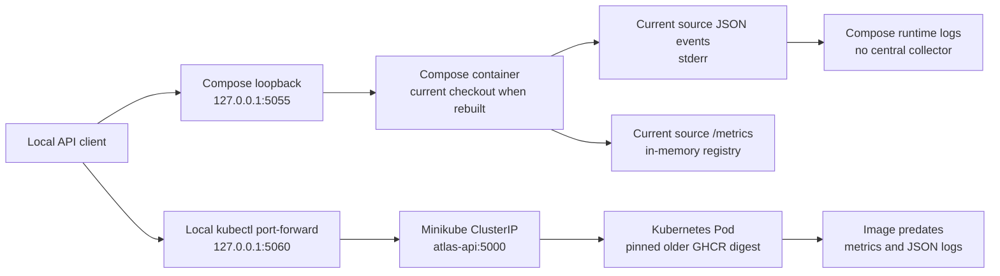

# Project Atlas

Project Atlas is a staged DevOps and Platform Engineering portfolio built around
a small Flask API. It demonstrates application packaging, container hardening,
automated validation and image publishing, a local Kubernetes smoke test, a
resource-free Terraform starting point, and application-level metrics and JSON
request logs.

It is a learning project, not a complete Internal Developer Platform or a
production service. There is no AWS infrastructure, database, authentication,
public ingress, Prometheus server, Grafana dashboard, or centralized log
pipeline in this repository.

## What is implemented

- A stateless Flask application factory with `GET /`, `/health`, `/info`, and
  `/version` endpoints.
- Prometheus-compatible request counters and latency histograms at `/metrics`,
  using bounded `method`, route-template, and status labels in a per-app
  in-memory registry.
- Structured JSON request-completion events with UTC timestamps, server-created
  `X-Request-ID` values, normalized route and method fields, status, and
  duration. Request bodies, headers, query strings, exception messages, and
  tracebacks are excluded.
- A digest-pinned Python container, one synchronous Gunicorn worker, and a
  loopback-only Docker Compose mapping with a read-only root filesystem and
  resource limits.
- GitHub Actions validation, Gitleaks source scanning, Trivy image scanning,
  and a separately permissioned GHCR publishing job.
- Kustomize manifests and an alternative Helm chart for a restricted, single
  replica Kubernetes workload.
- A Terraform AWS provider foundation targeting `ap-southeast-2`, with no
  resources defined.

## Current status and limitations

The repository contains committed application code, tests, container and CI
configuration, Kubernetes and Helm definitions, Terraform provider files, and
historical screenshots. The local Kubernetes smoke test was completed against
Minikube Kubernetes `v1.35.1` on the dedicated `atlas-smoke` profile. The
repository does not establish whether that profile is running now.

The Kustomize and Helm defaults now pin the verified immutable image
`ghcr.io/avinashmnth2507-dev/project-atlas@sha256:32cec7ad8da3303f038b15ca2b6369f6c86ba28c7ed8d4709ae164df729af5fa`,
published for source commit `989de965f9ea04f1f4292fa6c819aeb49daa8f31`.
The historical Minikube smoke test used an earlier image from commit
`d66b09be89258e0898ef559fc5c7b8e71b5ece32`; it does not validate the newly
pinned image or its metrics and structured logging in Kubernetes. The Helm
chart has been rendered and linted offline; it has not been installed into a
cluster.

The CI workflow reports HIGH and CRITICAL Trivy findings and blocks only on
CRITICAL findings. A local Trivy `0.71.1` comparison on 2026-10-22 observed 48
HIGH and 0 CRITICAL findings in the tested image with that day's cached
database. The workflow uses Trivy `0.76.1`; findings vary with scanner and
database versions. This historical result is not a current vulnerability
assessment, and the image is not vulnerability-free.

Several repository policy placeholders are still empty: `CHANGELOG.md`,
`CONTRIBUTING.md`, `CODE_OF_CONDUCT.md`, and `LICENSE`. Release notes,
contribution rules, a conduct policy, and licensing terms have not been
established in those files.

## Architecture at a glance

The diagram shows configured runtime paths, not a claim that a container or
cluster is running now. The Minikube lane is historical and uses the earlier
image from commit `d66b09be89258e0898ef559fc5c7b8e71b5ece32`; the committed
Kustomize and Helm defaults now pin the verified image from commit
`989de965f9ea04f1f4292fa6c819aeb49daa8f31`.



Compose and Kubernetes are separate runtime paths. The local port-forward was
used for the recorded Kubernetes smoke test; no public endpoint is configured.
`/metrics` is available on the application port, but no Prometheus server is
deployed to scrape it. JSON application logs go to stderr and are captured by
the container runtime; no log aggregation or retention service is configured.

For the component boundaries, delivery flow, ownership rules, and security
controls, see [ARCHITECTURE.md](ARCHITECTURE.md).

## Repository map

```text
app/                 Flask API, dependencies, and tests
Dockerfile           Hardened Gunicorn image
compose.yaml         Loopback-only local container service
.github/workflows/   CI, image scans, and conditional GHCR publishing
kubernetes/          Kustomize Namespace, Deployment, and Service
helm/atlas/          Alternative chart for the same workload
terraform/           AWS provider-only foundation
docs/                Architecture chapters and documentation navigation
screenshots/         Tracked historical project evidence
```

Only tracked paths are shown. Empty or ignored workspace directories do not
represent implemented components.

## Technology stack

| Area | Repository configuration or observed version |
| --- | --- |
| API | Python `>=3.14`; Flask `3.1.3`; application package `0.1.0` |
| WSGI and metrics | Gunicorn `26.1.0`; `prometheus-client` `0.26.0` |
| Tests and lint | pytest `>=8`; Ruff `0.17.1`; Python dependency pins in `app/requirements.txt` |
| Container | `python:3.14.9-slim-trixie` base pinned by digest; CI builds the application image for `linux/amd64` |
| Local container runtime | Docker CLI `24.0.6` observed; Compose version is not pinned by the repository |
| CI and security | GitHub Actions on Ubuntu `24.04`; Gitleaks `8.30.1`; Trivy CLI `0.76.1` |
| Kubernetes tooling | Smoke-test cluster `1.35.1`; Minikube `1.38.1`, kubectl `1.37.1`, Kustomize `5.8.1` observed |
| Helm | Chart API `v2`, chart and app version `0.1.0`; Helm CLI `4.1.4` was present during review |
| Terraform | Terraform `1.16.4`; AWS provider lock selection `6.70.0` |

CLI versions are environment observations, not all repository-enforced
requirements. There are no implemented Ansible, Jenkins, Grafana, Loki, Fluent
Bit, or AWS deployment components.

## CI, security scanning, and image publishing

The workflow in [`.github/workflows/ci.yml`](.github/workflows/ci.yml) runs for
pushes to `main`, pull requests targeting `main`, and manual dispatch. It
installs the application and development requirements, compiles Python, runs
Ruff, pytest, and `pip check`, scans tracked source with Gitleaks, builds a
`linux/amd64` image, and scans it with Trivy. HIGH findings are visible and
non-blocking; any CRITICAL finding fails the gate.

Only a successful push workflow for `main` transfers the scanned image through
a one-day Actions artifact to the publish job. The publish job verifies the
archive checksum and uses its `packages: write` permission and GitHub's
`GITHUB_TOKEN` to publish a `sha-<full-commit-sha>` tag to GHCR. No `main` or
`latest` tag is created. A CI workflow is configured to publish; this README
does not claim that the latest source commit has a successful run or published
image.

The image runs as UID/GID `10001`, uses a read-only root filesystem in Compose,
drops Linux capabilities, disables privilege escalation, and has bounded CPU,
memory, PID, `/tmp`, and Compose log-rotation settings. See
[app/README.md](app/README.md) for local development and logging details.

## Kubernetes, Helm, and Terraform

Kustomize and Helm describe the same `atlas-api` Deployment and `ClusterIP`
Service; they are alternative workload managers. The Kustomize set also defines
Namespace `atlas` with the Restricted Pod Security Admission label. The Helm
chart deliberately does not create or take ownership of the Namespace. Do not
manage the same Deployment and Service with both tools at once.

The workload has one replica, container port `5000`, `/health` startup,
readiness, and liveness probes, requests of `100m` CPU and `96Mi`, and limits
of `1` CPU and `256Mi`. It runs non-root, disables service-account token
automount, uses RuntimeDefault seccomp, drops all capabilities, has a
read-only root filesystem, and mounts a memory-backed `/tmp` capped at `16Mi`.
Both definitions now pin the verified image for source commit
`989de965f9ea04f1f4292fa6c819aeb49daa8f31`. This pin does not establish that
the image is deployed to a running cluster. See the
[Kubernetes guide](kubernetes/README.md) and [Helm chart guide](helm/atlas/README.md).

Terraform currently has only version constraints, the AWS provider, and an
`aws_region` variable defaulting to `ap-southeast-2`. There are no resource,
data, module, or backend blocks and no AWS environment has been provisioned by
this foundation. See [Terraform configuration](terraform/versions.tf) and the
[architecture overview](ARCHITECTURE.md#terraform-scope).

## Local quick start

Create the existing project virtual environment and run the tests from `app/`:

```bash
cd app
python3.14 -m venv .venv-atlas002
source .venv-atlas002/bin/activate
python -m pip install -r requirements-dev.txt
python -m pytest -q
python -m ruff check --select E4,E7,E9,F src tests run.py
python -m pip check
```

To run the Flask development server on loopback, from `app/`:

```bash
FLASK_ENV=development PYTHONPATH=src python -m flask \
  --app atlas:create_app run --host 127.0.0.1 --port 5000
```

Then request `/`, `/health`, `/info`, `/version`, or `/metrics` at
`http://127.0.0.1:5000`. The repository's `python run.py` entry point binds
`0.0.0.0:5000`; use it only on a trusted development network.

To build and run the current checkout with Compose from the repository root:

```bash
docker compose -f compose.yaml up --build --detach api
docker compose -f compose.yaml ps
curl --fail http://127.0.0.1:5055/health
docker compose -f compose.yaml logs --follow api
```

`--build` matters because the Compose image tag is a local tag and the service
also has a build context. The host port binds only to `127.0.0.1`. These
commands are instructions, not evidence that Docker is running now.

Offline manifest checks are:

```bash
kubectl kustomize ./kubernetes
helm lint --strict --namespace atlas ./helm/atlas
helm template atlas ./helm/atlas --namespace atlas --kube-version 1.35.1
```

They render local files and do not install or deploy a workload. The committed
Kustomize and Helm defaults pin the verified image for the current source;
repeat the Kubernetes smoke test against that pin before claiming current
cluster behavior. Follow the deployment ownership rules when choosing a path.

## Evidence and documentation

Tracked screenshots document selected historical steps:

- [CI run](screenshots/05-github-actions/18-ci-run-success.png)
- [Initial GHCR publication](screenshots/05-ghcr/19-ghcr-image-published.png)
- [Local Kubernetes smoke test](screenshots/07-kubernetes/20-kubernetes-local-smoke-test.png)

The Kubernetes screenshot records the earlier pinned image and does not prove
that the latest source was deployed. See [docs/README.md](docs/README.md) for
the documentation index and [docs/architecture/07-roadmap.md](docs/architecture/07-roadmap.md)
for milestone history and next steps.

## Milestone history

The completed sequence is: **ATLAS-001** repository foundation, **002** Python
and Flask API, **003** local container, **004** CI and security scanning,
**005** GHCR publishing, **006** isolated Kubernetes smoke test, **007**
resource-free Terraform, **008** Helm chart, **009** Prometheus metrics, and
**010** structured JSON request logging. The scope and evidence for each are
listed in the [roadmap](docs/architecture/07-roadmap.md).

## Documentation

- [Architecture and security boundaries](ARCHITECTURE.md)
- [Documentation index](docs/README.md)
- [Local setup and application commands](app/README.md)
- [Kubernetes resources and smoke-test record](kubernetes/README.md)
- [Helm chart and ownership prerequisites](helm/atlas/README.md)
- [Milestones, risks, and proposed next steps](docs/architecture/07-roadmap.md)

## Author

**Avinash Mani Tripathi** · [GitHub profile](https://github.com/avinashmnth2507-dev) ·
[Project Atlas repository](https://github.com/avinashmnth2507-dev/project-atlas)
