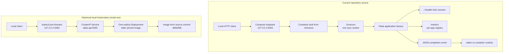
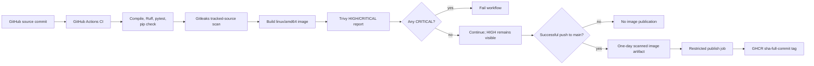

# 2. System architecture

## Component model

The application is a stateless Flask service. `atlas:create_app()` configures
the named logger, loads environment-derived application settings, registers
four blueprints, installs request logging, and initializes the Prometheus
metrics extension. The service has no database or persistent application
state.

The Compose path can build the current checkout. The Kubernetes path above is
historical: its committed Kustomize and Helm definitions pin a GHCR image from
before metrics and JSON request logging were added. It must not be read as a
deployment of current application source.

## Request and observability behavior

For each handled request, the application creates a UUID request ID and stores
the start time in Flask's request context. After response processing it adds
`X-Request-ID` and, except for successful health checks and metrics scrapes,
emits one `http.request.completed` JSON event. The event contains UTC timestamp,
level, ID, normalized method, Flask route template or `unmatched`, final status,
and elapsed milliseconds. The incoming ID header is ignored. Request IDs are
not metric labels.

Unexpected non-HTTP exceptions in production return a generic 500 response;
the log records the exception class without its message or traceback. In debug
mode the exception is re-raised for interactive diagnosis. Standard 404 and
405 HTTP exceptions remain handled by Flask and receive request IDs in the
response.

The Prometheus extension owns a separate `CollectorRegistry` for each Flask
application instance. Its counter and histogram use `method`, `route`, and
`status` only. The registry is process-local and the configured Gunicorn worker
count is one. No multiprocess mode or Prometheus server is configured.

There is no in-repository log collector or durable log destination. Compose
uses Docker's rotating `json-file` driver; Kubernetes log retention and
collection remain cluster-runtime concerns.

## CI and artifact flow

Validation also runs on pull requests and manual dispatch. Image publication
only runs for a successful push to `main`; the scanned image is transferred
through a one-day artifact and checked against its SHA-256 before the publish
job loads it. The validation job has `contents: read`; the publish job alone
has `packages: write` and receives GitHub's `GITHUB_TOKEN`. No mutable
`main`/`latest` image tag is created.

## Deployment ownership

Compose builds and runs a local container with a loopback host port. Kustomize
defines Namespace `atlas` plus its workload and Service. Helm renders the same
workload and Service but deliberately omits the Namespace. Helm and Kustomize
must not own the same Deployment and Service simultaneously. Switching methods
requires a reviewed ownership handoff or a separate namespace.

The Kustomize namespace carries
`pod-security.kubernetes.io/enforce=restricted`. The Helm release namespace
must already exist with that label; the chart does not take ownership of it.
The Kustomize Deployment and Helm templates use one replica, the same labels,
digest, probes, resource requests and limits, and security context.

## Trust boundaries

- Compose binds port `5055` to host loopback; it is not a public listener.
- Kubernetes uses a `ClusterIP` Service. The recorded local test used a
  loopback-only port-forward; no Ingress or load balancer exists.
- Routes, including `/metrics`, have no authentication or authorization.
  Keep access inside trusted boundaries until a separate access-control design
  is implemented.
- Logs omit raw URLs, headers, bodies, cookies, credentials, exception
  messages, and tracebacks. Request IDs are generated by the service and are
  not caller-controlled.
- GHCR publish credentials are provided to the publish job through
  `GITHUB_TOKEN`; the token is not embedded in the image or repository source.
- Terraform currently defines a provider only. It does not configure an AWS
  account, create resources, or establish remote state.

## Current limitations and extensions

The repository does not include authentication, TLS termination, rate
limiting, persistent storage, a database, horizontal scaling, high
availability, metrics scraping, dashboards, alerts, or centralized logs. The
single-worker metrics registry is not configured for multiple workers. The
production 500 event sacrifices traceback detail to avoid writing exception
contents to general logs. The Kubernetes image digest is stale relative to
current source. These constraints should be resolved deliberately before
claiming production readiness.

Reasonable extensions are a fresh image release and Kubernetes smoke test,
scrape and access-control design for metrics, a retention and redaction policy
before selecting a log backend, and a separately costed AWS and Terraform
state design.
